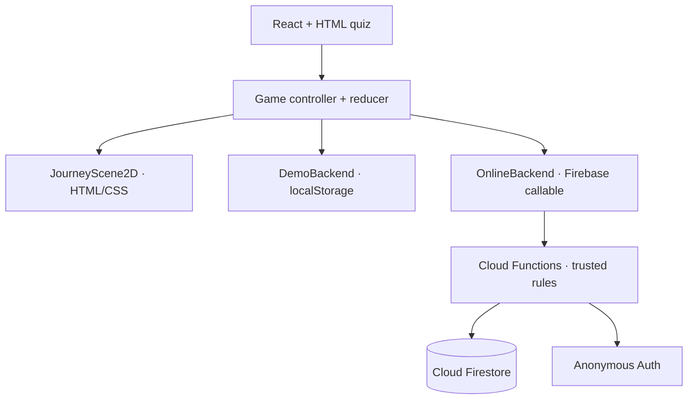
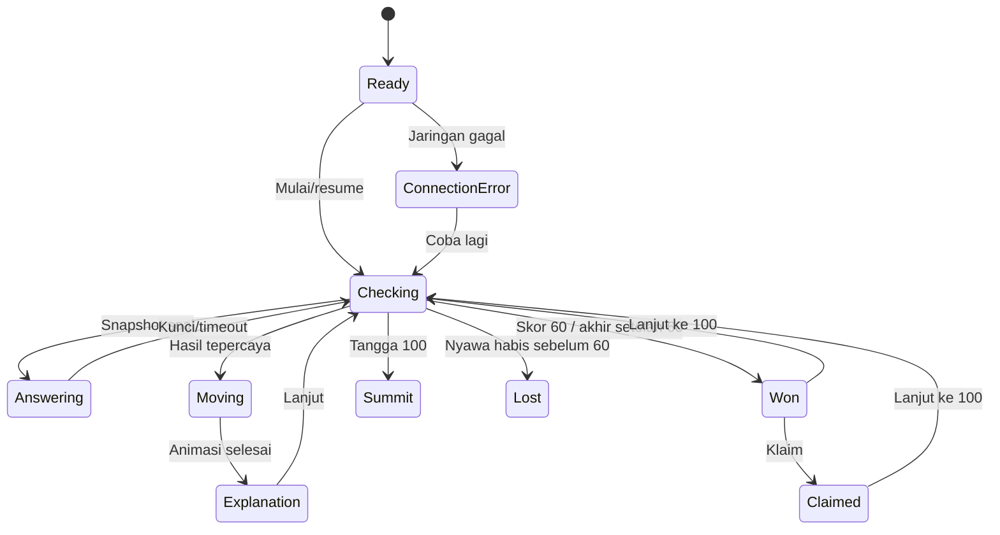

# Arsitektur dan state machine

## Arsitektur sistem

UI tidak pernah mengubah skor langsung. `BackendClient` membuat mode demo dan online memakai kontrak snapshot yang sama. Pada online, hanya Cloud Functions/Admin SDK dapat membaca kunci soal dan menulis sesi, klaim, kontak, serta leaderboard.

## State machine klien

| State | Aksi yang diizinkan |
|---|---|
| `ready` | mulai, petunjuk, Hall of Fame |
| `answering` | pilih, kunci jawaban, mute |
| `checking` | menunggu operasi idempoten, mute |
| `moving` | menunggu animasi, mute |
| `explanation` | baca hasil/sumber, Lanjut, mute |
| `won` | klaim, lanjut ke puncak, Hall of Fame, main lagi |
| `claimed` | lanjut ke puncak, Hall of Fame, main lagi |
| `lost` | Hall of Fame, main lagi |
| `connectionError` | coba lagi atau kembali |

## Batas kepercayaan

- Browser mengirim identitas sesi, turn, soal, opsi, dan `requestId`; browser tidak mengirim skor akhir, sisa waktu, atau status menang.
- Deadline, waktu mulai, kunci, skor, nyawa, dan outcome dihitung Functions memakai waktu server.
- Setiap mutasi online disimpan dalam transaksi Firestore bersama dokumen idempotensi.
- Resume memeriksa deadline. Timeout yang lewat memakai ID deterministik `timeout-{turnId}`, sehingga dicatat paling banyak sekali.
